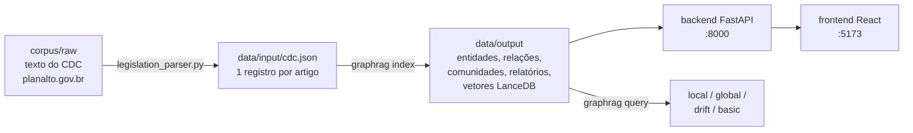

# GraphRAG aplicado ao Código de Defesa do Consumidor

Prova de conceito que aplica o [GraphRAG](https://github.com/microsoft/graphrag), da
Microsoft, à legislação consumerista brasileira: o texto do Código de Defesa do
Consumidor (CDC, Lei nº 8.078/1990) é transformado em um **grafo de conhecimento**
(entidades, relações, comunidades e relatórios de comunidade), que pode ser
explorado visualmente e consultado em linguagem natural.

Trabalho de Conclusão de Curso — Ciência da Computação, Universidade Federal do
Espírito Santo (UFES). Autora: Áurea Santos de Oliveira. Orientador: Prof. Dr. João
Paulo Almeida. O anteprojeto está em
[`docs/proposal/anteprojeto-aureaoliveira.pdf`](docs/proposal/anteprojeto-aureaoliveira.pdf).

## Objetivo

Investigar se a recuperação baseada em grafo do GraphRAG produz respostas mais
completas e de melhor qualidade sobre o CDC do que uma abordagem de RAG vetorial
tradicional. As quatro modalidades de busca do GraphRAG (**local**, **global**,
**drift** e **basic**) são comparadas, usando a busca *basic* (vetorial pura sobre o
mesmo corpus, com os mesmos modelos) como baseline. Assim, a única variável entre
as abordagens é a presença da estrutura de grafo.

## Arquitetura



Tudo roda em containers Docker, o que garante a reprodutibilidade do ambiente:

| Serviço    | Função                                                        | Porta  |
|------------|---------------------------------------------------------------|--------|
| `graphrag` | Indexação, *prompt-tune* e consultas via CLI (GraphRAG 3.1.0) | —      |
| `backend`  | API que lê os arquivos `.parquet` do índice                   | 8000   |
| `frontend` | Visualização interativa do grafo                              | 5173   |
| `ollama`   | Modelos locais (opcional, perfil `local`)                     | 11434  |

## Estrutura do repositório

```
.
├── app/
│   ├── backend/            # API FastAPI (routers, schemas, services)
│   └── frontend/           # React + TypeScript + Vite
├── config/
│   ├── .env.example        # modelo do data/.env (chaves de API)
│   ├── model_providers.yaml# blocos prontos para Anthropic e Google
│   └── settings.ollama.yaml# configuração alternativa 100% local
├── corpus/
│   ├── raw/                # texto bruto do CDC (planalto.gov.br)
│   └── parser/             # parser estrutural de legislação → JSON
├── data/                   # raiz do GraphRAG (estrutura padrão da ferramenta)
│   ├── settings.yaml       # configuração do pipeline e das buscas
│   ├── prompts/            # prompts usados pelo GraphRAG
│   ├── input/cdc.json      # corpus estruturado
│   └── output/ cache/ logs/# gerados pela indexação (fora do git)
├── docker/graphrag/        # imagem do GraphRAG (versão fixada)
├── docs/
│   ├── architecture.md     # arquitetura, API, eventos e banco
│   ├── implementation-log.md # registro detalhado de implementação (base do relatório)
│   ├── proposal/           # anteprojeto (PDF)
│   ├── reports/            # relatórios de acompanhamento
│   └── notes/              # anotações de trabalho
├── evaluation/             # avaliação comparativa (em construção)
├── scripts/                # utilitários (setup, teste de modelos, inspeção)
├── storage/                # SQLite do backend: histórico de consultas (fora do git)
└── docker-compose.yml
```

## O que foi feito até agora

### 1. Preparação do corpus

O texto oficial do CDC é convertido por `corpus/parser/legislation_parser.py` em
`data/input/cdc.json`, **um registro por artigo** (130 artigos). O parser segue a
técnica legislativa da LC nº 95/1998 e foi escrito para ser reaproveitável em
outras leis federais. Cada registro contém:

- **Hierarquia da lei**: título, capítulo, seção e subseção (número e nome) do artigo;
- **Id único e estável**, inclusive para artigos acrescidos por leis posteriores
  (`cdc_art_54-A`, `cdc_art_104-B`) e capítulos acrescidos (Capítulo VI-A);
- **Situação** do artigo (`vigente`, `vetado` ou `revogado`) e a lista de
  parágrafos, incisos e alíneas vetados ou revogados dentro dele. O texto vetado é
  mantido no corpus, pois o registro do veto também é informação jurídica
  (`--remover-vetados` gera a versão sem eles);
- **Texto completo** do artigo (caput, parágrafos, incisos e alíneas).

Na indexação, cada artigo cabe em um único *chunk*, e a hierarquia e a situação são
inseridas no início de cada *chunk* (`prepend_metadata`), dando ao modelo o
contexto de onde o trecho está na lei.

### 2. Taxonomia do domínio

A extração do grafo usa 14 tipos de entidade, que cobrem os seis títulos do CDC:

| Grupo | Tipos |
|---|---|
| Sujeitos | `consumidor`, `fornecedor`, `orgao_entidade` |
| Objeto da relação | `produto`, `servico`, `contrato` |
| Normativo | `direito`, `obrigacao`, `pratica_abusiva`, `instituto_juridico` (inclui princípios) |
| Consequências e tutela | `sancao_administrativa`, `infracao_penal`, `instrumento_processual` |
| Remissões | `dispositivo_legal` (artigos do CDC e outras normas citadas) |

O `graphrag prompt-tune` padrão não aceita uma taxonomia (ele descobre os tipos
sozinho e os grava no prompt, ignorando o `settings.yaml`). Por isso os prompts são
gerados por `scripts/prompt_tune.py`, que executa as mesmas etapas do prompt-tune
oficial, mas usa esta taxonomia, insere no prompt de extração uma **definição de cada
tipo** e **regras de nomeação** (ex.: `ART. 54-A DO CDC`, `LEI Nº 7.347/1985`; prazos
ficam na descrição, não viram entidades) e monta os exemplos a partir de artigos
escolhidos (arts. 49, 12, 42, 82, 66 e 56: curtos e cobrindo quase toda a taxonomia), em vez de sorteados.

### 3. Configuração dos modelos

A primeira versão rodava totalmente local (Ollama, `llama3.1:8b`), mas a qualidade
da extração era baixa e a indexação levava horas em CPU. A configuração atual usa
modelos em nuvem (OpenAI), escolhendo o modelo mais barato que atende bem cada etapa:

| Etapa                                   | Modelo                   |
|-----------------------------------------|--------------------------|
| Extração de entidades e relações        | `gpt-6.1-sol`            |
| Resumo de descrições de entidades       | `gpt-6-luna`             |
| Relatórios de comunidade                | `gpt-6.1-sol`            |
| Respostas (local, global, drift, basic) | `gpt-6.1-sol`            |
| Embeddings                              | `text-embedding-3-large` |

O corpus é pequeno (~22 mil tokens), então uma indexação completa custa poucos
dólares. A configuração local continua disponível em `config/settings.ollama.yaml`.

**Temperatura.** Os modelos GPT-6 são modelos de raciocínio e só aceitam
`temperature=1`. Na versão 3.x do GraphRAG, apenas a busca DRIFT define temperatura
própria (padrão 0); as demais usam o padrão do provedor. Para que a temperatura
não seja uma variável de confusão na comparação, ela foi fixada em 1 para todas as
etapas e buscas. Como as respostas variam entre execuções, cada pergunta da
avaliação será executada mais de uma vez.

### 4. Aplicação web

Três telas:

- **Grafo**: visualização interativa com filtros por tipo de entidade e comunidade,
  legenda e painel de detalhes.
- **Consultas**: perguntas em linguagem natural nas quatro modalidades (local, global,
  drift e basic), com o passo a passo exibido ao vivo: contexto recuperado (entidades,
  relações, relatórios de comunidade, trechos), pontos-chave da etapa map (global), árvore
  de perguntas de acompanhamento (DRIFT), prompt exato enviado ao modelo, resposta e
  métricas (chamadas ao LLM, tokens e tempo). Cada consulta mostra o **subgrafo usado
  como contexto** e pode destacá-lo no grafo completo.
- **Histórico**: todas as consultas ficam gravadas em SQLite com as etapas, o prompt e as
  métricas, associadas à versão do índice que as respondeu.

O backend usa a mesma biblioteca (GraphRAG 3.1.0), o mesmo `settings.yaml` e o mesmo
índice da CLI. Detalhes da arquitetura, da API e do banco em
[`docs/architecture.md`](docs/architecture.md). O registro detalhado de todas as
decisões, problemas e medições está em [`docs/implementation-log.md`](docs/implementation-log.md).

## Como executar

**Pré-requisitos:** Docker Desktop e, para o modo nuvem, uma chave de API da OpenAI
(com crédito e limite de gasto configurados).

### Modo nuvem (padrão)

```powershell
copy config\.env.example data\.env        # e preencha OPENAI_API_KEY
.\scripts\setup.ps1 -Index                 # sobe os containers, testa os modelos e indexa
```

Ou passo a passo:

```powershell
docker compose up -d --build
docker exec -it graphrag python /scripts/test_models.py    # confere chave e modelos (centavos)
docker exec -it graphrag graphrag index --root /data
docker compose restart backend                             # recarrega o grafo na API
```

Aplicação web: <http://localhost:5173> · API: <http://localhost:8000/docs>

Depois de reindexar, recarregue o índice no backend: `curl -X POST http://localhost:8000/api/index/reload` (ou `docker compose restart backend`).

### Modo local (Ollama, sem custo de API)

```powershell
copy config\settings.ollama.yaml data\settings.yaml
.\scripts\setup.ps1 -Local -Index
```

### Restaurar um índice publicado (sem reindexar)

Cada índice gerado é publicado na aba **Releases** do GitHub, com as pastas
`data/output`, `data/cache` e `data/logs`. Para usá-lo sem pagar uma nova indexação:

```powershell
git checkout v0.1.0                                     # código e prompts daquele índice
Expand-Archive graphrag-cdc-index-v0.1.0.zip -DestinationPath . -Force
docker compose restart backend
```

### Consultas

```powershell
docker exec -it graphrag graphrag query "O que diz o art. 54-E do CDC?" --root /data --method local
docker exec -it graphrag graphrag query "Quais são os direitos do consumidor superendividado?" --root /data --method drift
docker exec -it graphrag graphrag query "Quais são os principais temas do CDC?" --root /data --method global
docker exec -it graphrag graphrag query "O que é fornecedor segundo o CDC?" --root /data --method basic
```

### Outros comandos

| Tarefa                                    | Comando |
|-------------------------------------------|---------|
| Regerar o corpus a partir do texto bruto  | `docker exec -it graphrag python /corpus/parser/legislation_parser.py /corpus/raw/cdc_planalto.txt /data/input/cdc.json --lei-sigla CDC --lei-nome "Código de Defesa do Consumidor" --lei-numero "Lei nº 8.078, de 11 de setembro de 1990"` |
| Reindexar do zero (apaga o cache: paga as chamadas de novo) | `.\scripts\setup.ps1 -Clean -Index` |
| Ajustar os prompts ao corpus (com a taxonomia) | `docker exec -it graphrag python /scripts/prompt_tune.py` (o `graphrag prompt-tune` padrão ignora a taxonomia; ver o cabeçalho do script) |
| Inspecionar as tabelas do índice          | `docker exec -it graphrag python /scripts/inspect_output.py` |
| Gerar visualização HTML estática do grafo | `docker exec -it graphrag python /scripts/visualize_graph.py` (gera `data/output/graph.html`) |

## Próximos passos

- [ ] Indexar o corpus com os modelos em nuvem e validar manualmente entidades e relações
- [ ] Gerar os prompts com `scripts/prompt_tune.py` (taxonomia + modelo novo) e revisá-los
- [x] Consultas em linguagem natural na aplicação web, com o passo a passo e histórico
- [x] Destaque no grafo das entidades e relações usadas como contexto de cada consulta
- [ ] Definir o conjunto de perguntas e executar a avaliação comparativa (`evaluation/`)
- [ ] Publicar o índice congelado usado na avaliação como *Release*

## Tecnologias

GraphRAG 3.1.0 · LiteLLM · OpenAI API · Ollama · LanceDB · FastAPI · pandas ·
React 19 · TypeScript · Vite · Tailwind CSS · react-force-graph · Docker Compose
