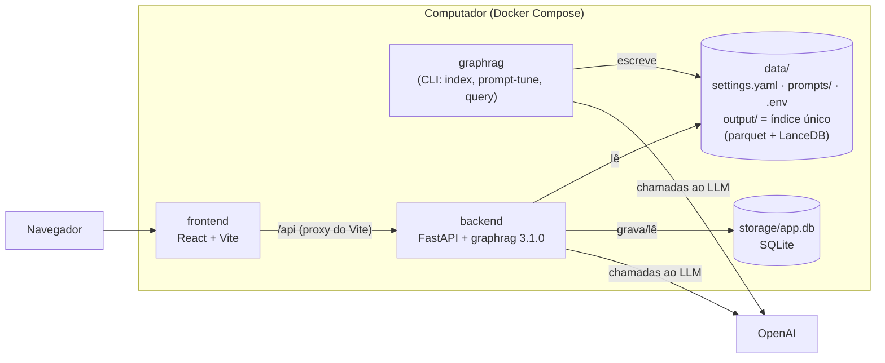

# Arquitetura

## Visão geral

- **Índice único.** `graphrag index` (container `graphrag`) gera `data/output`. O backend
  lê os mesmos arquivos, com a mesma versão do GraphRAG e o mesmo `settings.yaml`: uma
  consulta pela interface é equivalente à mesma consulta pela CLI.
- **O container `graphrag` não é um servidor**: é usado sob demanda para indexar, gerar
  prompts e consultar pela linha de comando.
- **Persistência**: o histórico de consultas fica em SQLite (`storage/app.db`), fora do git.
  Os resultados finais da avaliação são exportados para `evaluation/results/`.

## Fluxos

1. **Indexação** (rara): `cdc.json` → extração do grafo → comunidades → relatórios →
   embeddings → `data/output`. Depois de reindexar: `POST /api/index/reload` (ou reiniciar
   o backend).
2. **Consulta** (interface): `POST /api/query` → o backend monta o motor de busca do
   GraphRAG → cada etapa é enviada ao navegador por SSE **e** gravada no SQLite.
3. **Avaliação** (lote): script que chama a mesma API com `source = "evaluation"`,
   para N perguntas × 4 modalidades × repetições.

## API

| Método | Rota | Descrição |
|---|---|---|
| GET | `/api/graph`, `/api/communities`, `/api/meta` | Grafo para visualização |
| POST | `/api/query` | Consulta com etapas ao vivo (SSE). `?stream=false` devolve o registro completo |
| GET | `/api/runs` | Histórico (filtros: `method`, `source`, `status`, `evaluation_run_id`, `q`) |
| GET / DELETE | `/api/runs/{id}` | Consulta com todas as etapas / exclusão |
| GET | `/api/index` | Versão do índice em uso |
| POST | `/api/index/reload` | Recarrega o índice após reindexação |
| GET | `/api/health` | Estado do serviço |

Documentação interativa: <http://localhost:8000/docs>.

### Eventos da consulta (SSE e tabela `query_steps`)

| Evento | Modalidades | Conteúdo |
|---|---|---|
| `run` | todas | id da consulta, parâmetros, versão do índice |
| `context` | local, basic, drift, global | tabelas recuperadas (entidades, relações, relatórios, trechos) e o texto exato inserido no prompt |
| `prompt` | local, basic, global | mensagem de sistema final e pergunta enviadas ao modelo (na global, o prompt da síntese) |
| `map_start` / `map_end` | global | lotes de relatórios e pontos-chave (com nota) de cada lote |
| `reduce_start` / `reduce_end` | global, drift | entrada e saída da síntese; na DRIFT, a árvore de perguntas de acompanhamento |
| `token` | todas | pedaços da resposta conforme gerada (não gravado) |
| `result` | todas | resposta final, chamadas ao LLM, tokens de entrada/saída por etapa, tempo |
| `error` / `done` | todas | erro / fim do fluxo |

## Banco (SQLite)

| Tabela | Conteúdo |
|---|---|
| `index_versions` | impressão digital do índice (tabelas + settings + prompts), modelos, versão do GraphRAG |
| `query_runs` | pergunta, modalidade, parâmetros, origem, índice, resposta, métricas |
| `query_steps` | etapas de cada consulta (eventos acima, exceto `token`) |
| `questions` | perguntas de teste da avaliação |
| `evaluation_runs` | rodadas de avaliação (modalidades × repetições) |
| `assessments` | notas atribuídas manualmente às respostas |

## Observações de implementação (GraphRAG 3.1.0)

- **Busca basic quebrada no `search()` não streaming**: `BasicSearch.search()` chama
  `completion_async(stream=True)` sem `await` e sempre devolve resposta vazia (o erro é
  capturado internamente). A CLI não é afetada porque usa `stream_search`. O backend
  contorna com um invólucro do modelo (`_AwaitedStreamModel` em `query_service.py`).
  O bug também existe na 3.2.0.
- **Prompt ausente vira prompt padrão em silêncio**: `load_search_prompt` resolve o
  caminho relativo ao diretório atual e, se não achar, usa o prompt padrão em inglês sem
  avisar. O backend resolve os caminhos a partir de `data/` e falha se o arquivo não existir.
- **Contexto antes da resposta**: nas buscas local e basic o GraphRAG só notifica o
  contexto depois de gerar a resposta. O backend envolve o `build_context` da instância
  do motor para emitir o contexto e o prompt final antes da geração.
- As funções usadas (`query.factory`, `indexer_adapters`, `DataReader`) são internas do
  GraphRAG; por isso a versão está fixada nos dois containers.
